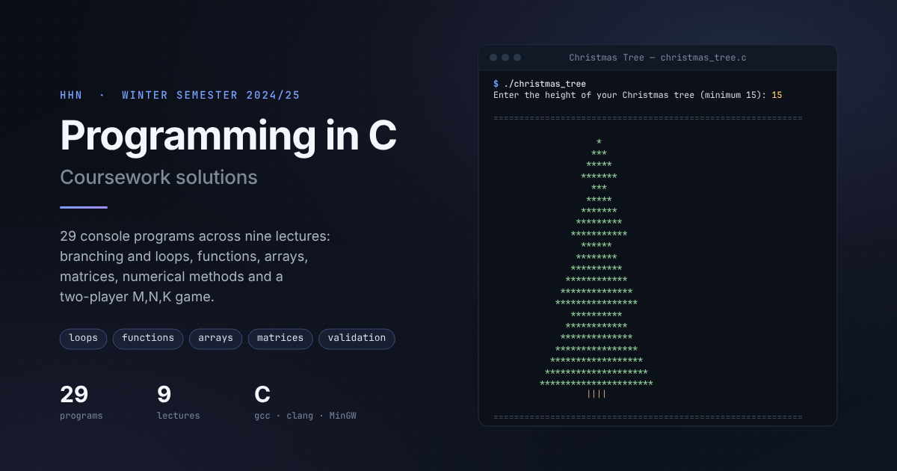
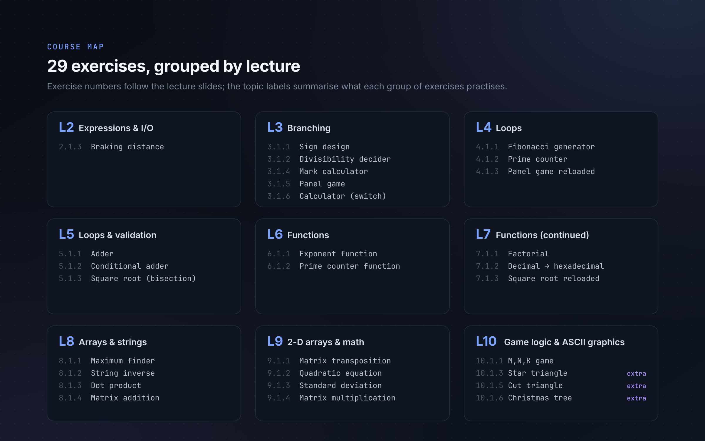
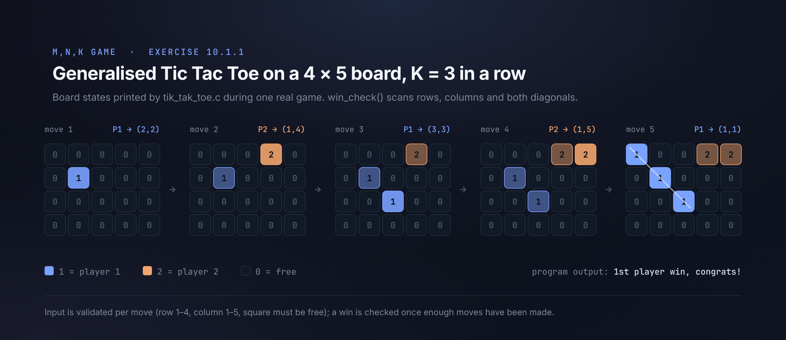
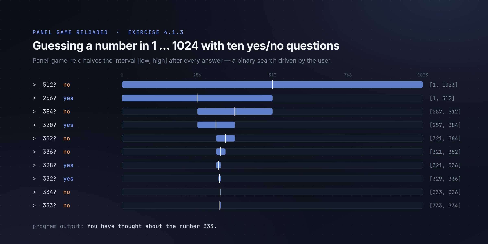
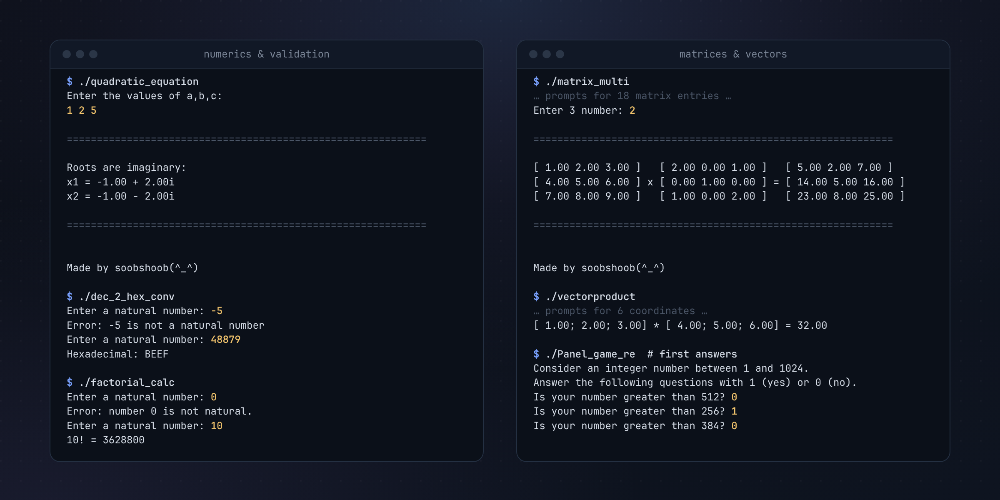

# HHN-WS24: Programming in C



Solutions to the 29 C programming exercises of the winter semester 2024/25 at Hochschule Heilbronn (HHN): from
expressions and branching to loops, functions, arrays, matrices, simple numerical methods and an interactive two-player
M,N,K game.

## Overview

The repository collects one standalone C program per exercise from the lecture slides of Prof. Dr. Ipek Saraç Heinz.
Each folder holds the source code, a Windows build, a screenshot of the original task and a screenshot of the code; some
also hold a screenshot of the program output. The exercises build on each other lecture by lecture:

- **Lectures 2–5:** input/output, `if`/`switch`, `while` and `for` loops, input validation by re-prompting.
- **Lectures 6–7:** splitting programs into functions (exponent, factorial, prime counter, number conversion).
- **Lectures 8–9:** one- and two-dimensional arrays, strings, vectors and 3 × 3 matrices, standard deviation and
  quadratic equations.
- **Lecture 10:** the M,N,K game and three extra ASCII-graphics tasks.

Several exercises come in a "reloaded" version that revisits an earlier task with a new language feature. Examples are
the panel game rewritten as a binary search over 1–1024, and the prime counter and square root moved into functions.

The course continues in [HHN-SS25](https://github.com/soobshoob/HHN-SS25) (recursion, strings, structs, file input).



## Technologies

| | |
|---|---|
| Language | C (C99 and later: `//` comments, declarations in `for`, variable-length arrays) |
| Standard library | `stdio.h` (`scanf`, `printf`, `getchar`), `math.h` (`sqrt`, `pow`), `string.h` (`strlen`) |
| Compilers | GCC 13 and Clang on Linux; the `.exe` files were built with MinGW GCC 6.3.0 (32-bit Windows) |
| Interface | Console only: prompts on `stdout`, answers from `stdin` |

## Highlights

### M,N,K game (exercise 10.1.1)

An M,N,K game generalises Tic Tac Toe: two players take turns on an M × N board, and whoever first occupies K squares in
a row, column or diagonal wins. The program uses a 4 × 5 board and K = 3. The board is a 2-D array in which `0` is free
and `1` or `2` marks a player. Each move is validated (row 1–4, column 1–5, square free) and the board is reprinted after
it. `win_check()` scans rows, columns and both diagonal directions and returns the result through pointer parameters.



### Panel game reloaded (exercise 4.1.3)

The program finds a number between 1 and 1024 with exactly ten questions of the form "Is your number greater than n?".
It keeps an interval `[low, high]` and halves it with every answer, which is binary search driven by the user. The run
below uses the answers from the task sheet and reaches the same result, 333.



### Numerics without library shortcuts

- **Square root** (5.1.3, 7.1.3): bisection on `[0, max(x, 1)]` until the interval is narrower than 10⁻⁶ (10⁻⁴ in the
  function version).
- **Decimal to hexadecimal** (7.1.2): repeated division by 16, digits 10–15 mapped to `A`–`F`, printed in reverse order.
- **Standard deviation** (9.1.3): sample standard deviation with `N − 1`, stored in a variable-length array.
- **Quadratic equation** (9.1.2): the sign of the discriminant selects real distinct, real equal or complex roots.
- **Christmas tree** (10.1.6): stacked, centred triangles; the number of layers, the width and the trunk scale with the
  requested height.

## Exercises

| Lecture | Exercise | Folder | What the program does |
|---|---|---|---|
| 2 | 2.1.3 | [Braiking_distance_calculator](Braiking_distance_calculator/) | Stopping time and braking distance from speed (km/h) and deceleration |
| 3 | 3.1.1 | [Sign design](Sign%20design/) | Classifies a number as positive, negative or zero |
| 3 | 3.1.2 | [Divisibility Decider](Divisibility%20Decider/) | Checks whether one integer divides another; rejects a zero denominator |
| 3 | 3.1.4 | [Mark calculator](Mark%20calculator/) | Maps a score from 0–100 to a grade from 1.0 to 4.0, or a fail |
| 3 | 3.1.5 | [Panel Game](Panel%20Game/) | Guesses a number from 1–8 with three yes/no questions |
| 3 | 3.1.6 | [Calculator](Calculator/) | Adds, subtracts, divides or multiplies two integers selected with `switch` |
| 4 | 4.1.1 | [Fibonacci_generator](Fibonacci_generator/) | Prints the first n Fibonacci numbers |
| 4 | 4.1.2 | [Prime counter reloaded](Prime%20counter%20reloaded/) | Prints the first n primes using trial division up to √n |
| 4 | 4.1.3 | [Panel game reloaded](Panel%20game%20reloaded/) | Binary search over 1–1024 in ten questions |
| 5 | 5.1.1 | [Adder](Adder/) | Sums 1 … n, re-prompting for negative input |
| 5 | 5.1.2 | [Conditional adder](Conditional%20adder/) | Sums the numbers in 0 … n that are divisible by 2 or 3 |
| 5 | 5.1.3 | [Square root calculator](Square%20root%20calculator/) | Square root by bisection |
| 6 | 6.1.1 | [Exponents funtction](Exponents%20funtction/) | `x^n` for a non-negative integer `n` in a separate function |
| 6 | 6.1.2 | [Prime counter function reloaded](Prime%20counter%20function%20reloaded/) | Prime listing as a function, repeated until the user stops |
| 7 | 7.1.1 | [Factorial calculator](Factorial%20calculator/) | Iterative `n!` with a validation function |
| 7 | 7.1.2 | [Decimal to Hexadecimal converter](Decimal%20to%20Hexadecimal%20converter/) | Converts a natural number to hexadecimal |
| 7 | 7.1.3 | [Square root calculator reloaded](Square%20root%20calculator%20reloaded/) | Bisection square root with separate check and root functions |
| 8 | 8.1.1 | [Maximum finder](Maximum%20finder/) | Maximum of six integers stored in an array |
| 8 | 8.1.2 | [Inverse](Inverse/) | Reverses a word character by character |
| 8 | 8.1.3 | [Vector product](Vector%20product/) | Dot (scalar) product of two 3-D vectors |
| 8 | 8.1.4 | [Matrix addition](Matrix%20addition/) | Adds two 3 × 3 matrices and prints them side by side |
| 9 | 9.1.1 | [Matrix transposition](Matrix%20transposition/) | Transposes a 3 × 3 matrix |
| 9 | 9.1.2 | [Quadratic equation](Quadratic%20equation/) | Real or complex roots of `ax² + bx + c` |
| 9 | 9.1.3 | [Standard deviation](Standart%20deviation/) | Sample standard deviation of N numbers |
| 9 | 9.1.4 | [Matrix multiplication](Matrix%20multiplication/) | Multiplies two 3 × 3 matrices |
| 10 | 10.1.1 | [Tik Tac Toe Game](Tik%20Tac%20Toe%20Game/) | Two-player M,N,K game on a 4 × 5 board, K = 3 |
| 10 | 10.1.3 (extra) | [Triangle with stars](Triangle%20with%20stars/) | Centred star triangle with n rows |
| 10 | 10.1.5 (extra) | [Cutted triangle with insertions](Cutted%20triangle%20with%20insertions/) | Triangle that starts at a given row, shifted right by a given indent |
| 10 | 10.1.6 (extra) | [Christmas Tree](Christmas%20Tree/) | Layered ASCII Christmas tree for a height of 15 or more |

Exercise numbers come from the lecture slides, so `Ctrl+F` for e.g. "9.1.4" finds the matching task. Folder names are
kept as submitted.

## Project structure

```text
HHN-WS24/
├── <Exercise name>/
│   ├── <program>.c            solution source
│   ├── <program>.exe          Windows build (MinGW, 32-bit)
│   ├── Screenshot_task.png    original task from the lecture slides
│   ├── screenshot_code.png    screenshot of the solution code
│   └── Screenshot_result.png  terminal output (some exercises)
├── docs/assets/               README images; source/ holds their SVG sources
└── scripts/build.sh           builds every program into build/
```

Screenshot names differ slightly between folders (for example `Screenshot_code.png` in `Inverse` and
`screenshot_code.jpg` in `Panel Game`).

## Build and run

Requirements: a C compiler (GCC or Clang) and the maths library. On Windows, use the included `.exe` files, or build
under WSL or MSYS2.

Build all programs into `build/` (ignored by Git):

```bash
sh scripts/build.sh
```

The script uses `cc` by default. To pick a compiler, set `CC`:

```bash
CC=clang sh scripts/build.sh
```

Build and run a single program:

```bash
gcc "Tik Tac Toe Game/tik_tak_toe.c" -o tik_tak_toe && ./tik_tak_toe
```

None of the programs read files; all input is typed at the prompts. Some programs wait for Enter before they exit, so
the console window stays open when the `.exe` is started by double-click.

## Usage examples

Real runs of the programs built with `scripts/build.sh`; typed input follows the prompts.

```text
$ ./build/Panel_game_re
Consider an integer number between 1 and 1024.
Answer the following questions with 1 (yes) or 0 (no).
Is your number greater than 512? 0
Is your number greater than 256? 1
Is your number greater than 384? 0
Is your number greater than 320? 1
Is your number greater than 352? 0
Is your number greater than 336? 0
Is your number greater than 328? 1
Is your number greater than 332? 1
Is your number greater than 334? 0
Is your number greater than 333? 0
You have thought about the number 333.
```

```text
$ ./build/dec_2_hex_conv
Enter a natural number: -5
Error: -5 is not a natural number
Enter a natural number: 48879
Hexadecimal: BEEF
```

```text
$ ./build/standart_deviation
Enter the number of elements: 4
Enter element 1: 5
Enter element 2: 6
Enter element 3: 1
Enter element 4: 10

============================================================

Standard deviation: 3.70

============================================================

Made by soobshoob(^_^)
```

More runs, covering input validation, complex roots and matrix output:



## Technical challenges and learning outcomes

- **Robust console input.** The matrix, statistics and game programs re-prompt with `while (scanf(...) != 1)` and clear
  the input buffer (`while (getchar() != '\n')`), so a typed letter does not derail the program. Earlier exercises
  re-prompt only on out-of-range numbers.
- **From loops to functions.** The "reloaded" exercises move logic out of `main` into functions with parameters and
  return values (`isprime`, `root`, `check`, `hex_count`), and later into functions that write results through pointers
  (`win_check`, `move1pl`).
- **2-D arrays as parameters.** The matrix programs and the game pass arrays as `float arr[][3]` or `int G[][5]` and
  format several matrices side by side on one line.
- **Algorithms behind simple tasks.** Bisection, binary search, trial division up to √n and base conversion each appear
  as a small, self-contained exercise.
- **Text layout by arithmetic.** The triangle and tree exercises derive the spaces and stars of every row from the row
  index, the layer and the maximum width.

Known limitations, kept as submitted:

- `factorial_calc` uses `int`, so results from `13!` on overflow (`13! = 1932053504`).
- `calculator` does not guard against division by zero and stops with a floating-point exception.
- `exponents_func` handles only non-negative exponents; for a negative `n` it returns 1.
- The M,N,K game checks diagonals for exactly three squares, matching its K = 3, and has no draw detection for a full
  board. The task sheet starts from a 5 × 4 board; the program uses 4 × 5.
- The input-validation loops expect interactive input; if `stdin` ends early (for example, with piped input) they
  loop endlessly.

## Source

The exercises come from the lecture presentations of Prof. Dr. Ipek Saraç Heinz, Hochschule Heilbronn. This repository
is meant for personal learning, reference and practice.
